<p align="center">
  
</p>

# 🎯 Awesome Predictive Lead Scoring & Qualification

<p align="left">
  <a href="https://github.com/ishandutta2007/Awesome-Awesome-Awesome"></a>
  <a href="https://discord.gg/jc4xtF58V"></a>
  <a href="https://github.com/ishandutta2007/Awesome-Awesome-Awesome"></a>
  <a href="http://makeapullrequest.com"></a>
  <a href="https://github.com/ishandutta2007"></a>
</p>

> 🚀 **A comprehensive, SEO-optimized curated directory of enterprise SaaS platforms, AI-driven qualification frameworks, and open-source self-hosted scoring engines.** Master behavioral signal detection, account-based marketing (ABM) prioritization, product-qualified lead (PQL) discovery, and closed-won predictive modeling.

---

## 📑 Table of Contents
- [🌐 Sector Overview & Market Dynamics](#-sector-overview--market-dynamics)
- [🏢 Enterprise SaaS Platforms](#-enterprise-saas-platforms)
- [💻 Open-Source GitHub Projects](#-open-source-github-projects)
  - [🤖 AI Scoring Engines & GTM Command Frameworks](#-ai-scoring-engines--gtm-command-frameworks)
  - [🧠 Machine Learning Models & Reference Implementations](#-machine-learning-models--reference-implementations)
- [🔍 Key Evaluation Criteria & Architecture Comparison](#-key-evaluation-criteria--architecture-comparison)
- [🤝 How to Contribute](#-how-to-contribute)
- [💖 Support](#-support)
- [⭐ Star History](#-star-history)
- [⚖️ Disclaimer & Data Governance](#️-disclaimer--data-governance)

---

## 🌐 Sector Overview & Market Dynamics

The global **Predictive Lead Scoring & Sales Analytics** software market is valued at approximately **$2.5 Billion** and is projected to surpass **$7.0 Billion by the mid-2030s**, compounding at an estimated **14.2%–18.5% CAGR**. 

Market competition remains **moderately to highly fragmented** rather than a winner-take-all monopoly: foundational CRM giants (such as HubSpot and Salesforce) bundle standard native scoring modules, while specialized revenue intelligence platforms (such as 6sense, Demandbase, and MadKudu) capture high-value enterprise accounts via proprietary multi-touch intent networks, third-party firmographic enrichment, and machine learning models trained on closed-won pipeline history.

---

## 🏢 Enterprise SaaS Platforms

Below is an overview of top SaaS predictive lead scoring and account qualification platforms, sorted in descending order by company scale (market capitalization, annual revenue, or enterprise valuation):

| Platform | Company Scale (Valuation / Revenue) 🏢 | Pricing (Starting Tier) 💵 | Free Tier / Free Trial Limits 🎁 | Primary Capabilities & Best Use Case 🎯 |
| :--- | :--- | :--- | :--- | :--- |
| **[HubSpot](https://www.hubspot.com/)** | **~$28B+ Market Cap** ($2.1B+ Annual Revenue) | **$15/mo** (Starter Customer Platform) / **$800/mo** (Marketing Hub Pro for Predictive Lead Scoring) | **Free Forever Plan** (up to 1,000,000 contacts, basic forms & CRM); **14-day free trial** for Professional/Enterprise tiers | Native predictive lead scoring, automated behavioral event tracking (email clicks, page visits), multi-channel attribution. |
| **[ZoomInfo](https://www.zoominfo.com/)** | **~$4.5B+ Market Cap** ($1.2B+ Annual Revenue) | **$14,995/year** (~$1,250/mo minimum annual commitment) | **ZoomInfo Lite** (Free forever with Community Edition, 10–25 credits/mo via web extension exchange); sales-coordinated trial | B2B contact intelligence, ZoomInfo Score, firmographic enrichment, technographic profiling, and live buying intent spikes. |
| **[6sense](https://6sense.com/)** | **$5.2B Valuation** (Late-stage Unicorn) | **$40,000/year** (~$3,333/mo base enterprise deployment) | **Free Plan** (Revenue AI for Sales: 50 free credits/month, prospecting Chrome extension); custom sandbox upon demo | Account-based predictive intelligence, dark funnel intent tracking via bidstream data, buying stage prediction (6QA). |
| **[Demandbase](https://www.demandbase.com/)** | **$1.0B+ Valuation** ($200M+ Estimated ARR) | **$65,000/year** (Median contract via Vendr; ~$5,400/mo + implementation) | **No Free Plan or Public Trial** (Requires sales discovery, custom demo, and guided proof-of-concept) | End-to-end B2B ABM suite, account intent scores, predictive pipeline engagement, and unified DSP ad targeting. |
| **[Leadspace](https://www.leadspace.com/)** | **$300M+ Valuation** (Venture / Private Equity Backed) | **$25,000/year** (~$2,080/mo entry contract for unified profiles) | **No Free Plan or Public Trial** (Enterprise proof-of-concept scoping with dedicated sales team) | B2B Customer Data Platform (CDP), AI profile unification, third-party graph enrichment, and fit-predictive scoring. |
| **[Infer](https://www.infer.com/)** | **$150M+ Historical Valuation** (Ignite Technologies) | **$30,000/year** (~$2,500/mo or Ignite Prime enterprise suite license) | **No Free Plan or Public Trial** (Available via Ignite Unlimited enterprise software license pool) | Pioneering machine learning lead scoring engine, firmographic matching, conversion probability, and CRM lead routing. |
| **[MadKudu](https://www.madkudu.com/)** | **$60M+ Valuation** (Part of HG Insights) | **$999/month** (Growth plan; ~$33,000 median annual contract) | **No Free Forever Plan**; 14-day guided proof-of-concept pilot available via sales qualification | Predictive scoring models trained directly on your historical closed-won CRM deals; Product-Qualified Lead (PQL) algorithms. |
| **[Salespanel](https://salespanel.io/)** | **$10M–$25M Valuation** (Privately Held / Bootstrapped) | **$99/month** (Basic plan, up to 2,000 tracked visitors/month) | **14-day full-feature free trial** (No credit card required, covers all visitor tracking & scoring features) | First-party visitor tracking, behavioral score rules, lead temperature tracking, and real-time CRM data synchronization. |
| **[Breadcrumbs.io](https://breadcrumbs.io/)** | **$5M–$15M Valuation** (Privately Held Startup) | **$790/month** (Pro plan with live CRM bidirectional sync & automated routing) | **Free Forever Plan** ("Breadcrumbs Reveal" tool, analyzes up to 10,000 contacts for ICP directory & exploratory scoring) | Co-dynamic scoring combining demographic/fit and real-time recency/frequency product-usage activity. |

---

## 💻 Open-Source GitHub Projects

Explore the leading self-hosted, MIT/Apache/AGPL licensed predictive lead scoring repositories, sorted in descending order by GitHub_Stars ⭐.

### 🤖 AI Scoring Engines & GTM Command Frameworks

| Repository | GitHub_Stars 🌟 | Primary Stack 🛠️ | Description & Architectural Highlights ⚡ |
| :--- | :--- | :--- | :--- |
| **[Gingiris/growth-tools](https://github.com/Gingiris/growth-tools)** | [](https://github.com/Gingiris/growth-tools/stargazers) | TypeScript, Node.js | Automated inbound/outbound lead acquisition from Reddit, Discord, and GitHub. Employs hybrid LLM scoring (50% deterministic heuristics + 50% LLM intent extraction) with automated personalized outreach drafts. |
| **[daddydrac/Machine-Learning-For-Predictive-Lead-Scoring](https://github.com/daddydrac/Machine-Learning-For-Predictive-Lead-Scoring)** | [](https://github.com/daddydrac/Machine-Learning-For-Predictive-Lead-Scoring/stargazers) | Python, Scikit-learn, Pandas | Production-tested end-to-end machine learning pipeline for predictive lead scoring. Identifies high-propensity leads, reduces sales cycle duration, and prevents customer churn with supervised classification models. |
| **[mukulsinghal001/lead-scoring-model-python](https://github.com/mukulsinghal001/lead-scoring-model-python)** | [](https://github.com/mukulsinghal001/lead-scoring-model-python/stargazers) | Python, Jupyter, Scikit-learn | Comprehensive lead conversion model utilizing logistic regression, decision trees, and random forests on educational CRM leads with precision/recall optimization and sensitivity tuning. |
| **[UponRain83246/ai-telegram-business-bot-n8n-resocket](https://github.com/UponRain83246/ai-telegram-business-bot-n8n-resocket)** | [](https://github.com/UponRain83246/ai-telegram-business-bot-n8n-resocket/stargazers) | n8n, Python, Telegram API | Multi-modal automated lead qualification workflow featuring voice/text/image recognition, dual-AI model fallback, budget/timeline parsing, and self-healing CRM sync. |
| **[KlementMultiverse/ai-crm-agents](https://github.com/KlementMultiverse/ai-crm-agents)** | [](https://github.com/KlementMultiverse/ai-crm-agents/stargazers) | Python, LangChain, FastAPI | Multi-agent autonomous sales CRM architecture with dedicated AI agents for automated lead qualification, email intelligence, meeting booking, and pipeline routing. |
| **[Othmane-Khadri/gtm-engineer-playbook](https://github.com/Othmane-Khadri/gtm-engineer-playbook)** | [](https://github.com/Othmane-Khadri/gtm-engineer-playbook/stargazers) | Markdown, Bash, Claude Code | 10 modular sales intelligence skills transforming terminal sessions into a GTM command center: ICP scoring, buying signal monitoring, automated sequence generation, and battlecards. |
| **[LiChang1125/B2B_Sales_Agent_Skill](https://github.com/LiChang1125/B2B_Sales_Agent_Skill)** | [](https://github.com/LiChang1125/B2B_Sales_Agent_Skill/stargazers) | Python, LLM Orchestration | B2B sales automation skill performing real-time multi-dimensional qualification, enterprise objection handling, product Q&A, and CRM deal-stage updates. |
| **[LensmorOfficial/trade-show-skills](https://github.com/LensmorOfficial/trade-show-skills)** | [](https://github.com/LensmorOfficial/trade-show-skills/stargazers) | Python, Shell, LLM Agents | 15 reusable GTM agent skills built for automated trade show attendee scraping, competitor discovery, budget qualification, and post-conference lead triage. |
| **[olivierzach/tricentis-lead-scoring](https://github.com/olivierzach/tricentis-lead-scoring)** | [](https://github.com/olivierzach/tricentis-lead-scoring/stargazers) | Python, Scikit-learn, XGBoost | Rigorous lead-scoring data analysis detailing ranking metrics, lift curves, precision-recall trade-offs, and probability calibration for B2B conversions. |
| **[getbeton/inspector](https://github.com/getbeton/inspector)** | [](https://github.com/getbeton/inspector/stargazers) | TypeScript, Node.js, Next.js | Open-source, privacy-first **MadKudu & Pocus alternative** (AGPLv3). Ingests PostHog behavioral events and synchronizes directly with HubSpot, Attio, and Pipedrive to identify product qualified leads (PQLs). |
| **[Astoriel/LeadGenius](https://github.com/Astoriel/LeadGenius)** | [](https://github.com/Astoriel/LeadGenius/stargazers) | Python, Docker, FastAPI | Open-source B2B lead scoring and routing engine. Self-hosted alternative to Clearbit and MadKudu featuring waterfall enrichment, YAML rule configuration, and instant Slack/HubSpot webhooks. |
| **[calvdee/end-to-end-lead-scoring](https://github.com/calvdee/end-to-end-lead-scoring)** | [](https://github.com/calvdee/end-to-end-lead-scoring/stargazers) | Python, Scikit-learn, MLflow | Enterprise-grade reference implementation demonstrating data preprocessing, categorical feature encoding, logistic/random forest modeling, and model evaluation metrics. |
| **[eduardocornelsen/full-funnel-ai-analytics](https://github.com/eduardocornelsen/full-funnel-ai-analytics)** | [](https://github.com/eduardocornelsen/full-funnel-ai-analytics/stargazers) | Python, dbt, DuckDB, XGBoost | Full-funnel AI marketing stack utilizing dbt MetricFlow and MCP. Features multi-warehouse analytics, ad attribution, and integrated XGBoost lead scoring on $0/month open architecture. |
| **[theaifutureguy/AI-Agent-for-Telephony-voice-bot](https://github.com/theaifutureguy/AI-Agent-for-Telephony-voice-bot)** | [](https://github.com/theaifutureguy/AI-Agent-for-Telephony-voice-bot/stargazers) | Python, Twilio, OpenAI, WebRTC | Autonomous voice-based telephonic agent for real-time customer discovery, voice questionnaire scoring, appointment booking, and instant CRM qualification. |
| **[BayramAnnakov/lead-qualification-plugin](https://github.com/BayramAnnakov/lead-qualification-plugin)** | [](https://github.com/BayramAnnakov/lead-qualification-plugin/stargazers) | Python, Claude Code Skill | Inbound lead qualification plugin utilizing the Fit + Intent + Timing (FIT) scoring matrix to triage prospective inbound requests inside developer terminals. |
| **[BookletAI/lead-scoring-demo](https://github.com/BookletAI/lead-scoring-demo)** | [](https://github.com/BookletAI/lead-scoring-demo/stargazers) | Python, Jupyter, AWS SageMaker | End-to-end cloud lead scoring prototype with Jupyter notebooks, MLflow experiment tracking, and SageMaker model hosting. |
| **[himanshusaleria/gtm-engine](https://github.com/himanshusaleria/gtm-engine)** | [](https://github.com/himanshusaleria/gtm-engine/stargazers) | Bash, Python, Claude Code | Sales enablement suite for 0-to-1 founders: pipeline progression, conversational call transcription parsing, lead prioritization, and outbound triggers. |
| **[getcargohq/cargo-skills](https://github.com/getcargohq/cargo-skills)** | [](https://github.com/getcargohq/cargo-skills/stargazers) | Rust, TypeScript, CLI | GTM agent toolkits connecting to 138 CRM integrations and 50 data providers for waterfall enrichment, intent monitoring, and lead qualification directly from LLMs. |
| **[SalesforceLabs/LeadScoring](https://github.com/SalesforceLabs/LeadScoring)** | [](https://github.com/SalesforceLabs/LeadScoring/stargazers) | Apex, Salesforce DX | Official Salesforce Labs package providing configurable declarative and formula-based rules to score inbound leads directly inside Salesforce orgs. |
| **[hitb1099/outreach-os](https://github.com/hitb1099/outreach-os)** | [](https://github.com/hitb1099/outreach-os/stargazers) | n8n, OpenAI, GLM-4, Python | Autonomous outbound outreach operating system connecting Google Places scraping, AI lead scoring, personalized email drafting, and reply tracking. |
| **[Nikkk2312/ai-lead-scoring-engine](https://github.com/Nikkk2312/ai-lead-scoring-engine)** | [](https://github.com/Nikkk2312/ai-lead-scoring-engine/stargazers) | Python, FastAPI, Docker | Comprehensive B2B scoring engine: 136 engineered features, tri-dimensional matrix (Fit/Engagement/Intent), 6sense-style buying stages, Kanban pipeline, and local LLM explanation generation. |
| **[loootai/looot-warm-leads](https://github.com/loootai/looot-warm-leads)** | [](https://github.com/loootai/looot-warm-leads/stargazers) | Python, TypeScript | Algorithmic listener tracking social, web, and tech-stack change signals to score account warmness and dispatch outbound notifications. |
| **[loootai/looot-score](https://github.com/loootai/looot-score)** | [](https://github.com/loootai/looot-score/stargazers) | Python, MIT License | Transparent firmographic scoring framework rebuilding the data evaluation layer of MadKudu using explicit rule-weight distributions. |
| **[WaltGreenwich/ai-lead-agent](https://github.com/WaltGreenwich/ai-lead-agent)** | [](https://github.com/WaltGreenwich/ai-lead-agent/stargazers) | FastAPI, Google Gemini, n8n | AI qualification pipeline using Gemini to parse intent, urgency, budget constraints, and lead category into Airtable and CRM webhooks. |

---

### 🧠 Machine Learning Models & Reference Implementations

| Repository | GitHub_Stars 🌟 | Stack 🛠️ | Focus Area 🔬 |
| :--- | :--- | :--- | :--- |
| **[avrtt/Cuana-E2E](https://github.com/avrtt/Cuana-E2E)** | [](https://github.com/avrtt/Cuana-E2E/stargazers) | Python, XGBoost, Plotly Dash | Full-lifecycle customer intelligence suite covering supervised XGBoost lead scoring, customer lifetime value (CLV) calculation, and churn segmentation. |
| **[denis911/kaggle-lead-scoring-v3-data-analysis-modeling-and-cloud-deployment](https://github.com/denis911/kaggle-lead-scoring-v3-data-analysis-modeling-and-cloud-deployment)** | [](https://github.com/denis911/kaggle-lead-scoring-v3-data-analysis-modeling-and-cloud-deployment/stargazers) | Python, XGBoost, Docker | End-to-end cloud pipeline deploying a high-accuracy (~0.88 AUC) XGBoost classification inference API with Docker and categorical leakage guards. |
| **[jylee0912/lead-scoring-kan](https://github.com/jylee0912/lead-scoring-kan)** | [](https://github.com/jylee0912/lead-scoring-kan/stargazers) | PyTorch, Python | Experimental deep learning research applying Kolmogorov-Arnold Networks (KAN) to lead conversion prediction benchmarked against traditional gradient boosting. |

---

## 🔍 Key Evaluation Criteria & Architecture Comparison

When designing a modern revenue qualification pipeline, organizations typically balance three distinct architectural approaches:

```
┌─────────────────────────────────────────────────────────────────────────────────┐
│                     Predictive Lead Qualification Spectrum                      │
├─────────────────────────┬─────────────────────────────┬─────────────────────────┤
│    Heuristic Rules      │      Proprietary SaaS       │   Self-Hosted AI / ML   │
│  (HubSpot / Breadcrumbs)│   (MadKudu / 6sense / ZI)   │   (Beton / LeadGenius)  │
├─────────────────────────┼─────────────────────────────┼─────────────────────────┤
│ • Deterministic point   │ • Trained on closed-won data│ • Zero per-seat fee     │
│   additions/subtractions│ • Multi-tenant intent graphs│ • Total data privacy    │
│ • Highly inspectable    │ • Expensive ($10k-$60k+/yr) │ • LLM signal detection  │
│ • Brittle to anomalies │ • Opaque black-box models   │ • Requires ML / DevOps  │
└─────────────────────────┴─────────────────────────────┴─────────────────────────┘
```

1. **Closed-Won Model Training (Commercial Advantage):** Platforms like **MadKudu** distinguish themselves by training machine learning models on your team's specific closed-won deal patterns. In contrast, open-source platforms largely focus on heuristics, LLM prompts, or synthetic benchmark models.
2. **Behavioral vs. Firmographic Signals:** Top systems (such as **Beton** and **6sense**) blend behavioral product telemetry (e.g. via PostHog or Segment) with technographic and demographic profiles to prevent false-positive MQLs.
3. **Data Privacy & GDPR:** Self-hosted open-source stacks (**LeadGenius**, **ai-lead-scoring-engine**) ensure consumer telemetry never exits your self-hosted cloud VPC or Docker infrastructure.

---

## 🤝 How to Contribute

Contributions are welcome and actively encouraged!

1. 🍴 **Fork** the repository.
2. 🌿 **Create** a descriptive branch (`git checkout -b feature/add-new-scoring-engine`).
3. 📝 **Add/Update** entries in `README.md` keeping formatting consistent (include name, URL, transparent pricing or Stars_Badges).
4. 🚀 **Submit** a pull request with a concise overview of the tool.

---

## 💖 Support

Thank you for exploring and utilizing this curated directory! If you found this resource helpful for your team, sales research, or AI/RevOps engineering workflows, please consider supporting the project:

- ⭐ **Star this repository** to help others discover it across GitHub.
- 🍴 **Fork and contribute** new open-source scoring engines, SaaS platforms, or benchmark results.
- 📢 **Share** with your fellow data scientists, growth engineers, and RevOps peers.
- ☕ **Buy a coffee / Sponsor**: Support ongoing maintenance and curation on the [GitHub Sponsor Dashboard](https://github.com/sponsors/ishandutta2007).

---

## ⭐ Star History

[](https://star-history.dera.page/#ishandutta2007/Awesome-Predictive-Lead-Scoring-Qualification&type=date&legend=top-left)

---

## ⚖️ Disclaimer & Data Governance

- **Community Maintained:** This repository is an open-source, community-curated directory for research and engineering reference. Mentioning a company or tool does not constitute an endorsement.
- **Privacy & Compliance:** Processing lead telemetry, scraping public web records, and deploying automated scoring models must adhere strictly to GDPR, CCPA, and regional marketing compliance regulations. Predictive models trained on unweighted historical pipeline data can inherit bias and should undergo continuous algorithmic auditing.
- **Open-Source Reality:** Always verify software license terms (MIT, AGPLv3, Apache 2.0) before deploying within commercial enterprise revenue operations.

---

<p align="center">
  <sub>Maintained with ❤️ by the open-source RevOps &amp; Machine Learning community.</sub>
</p>
